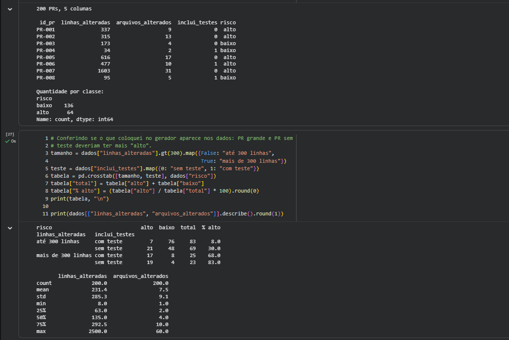
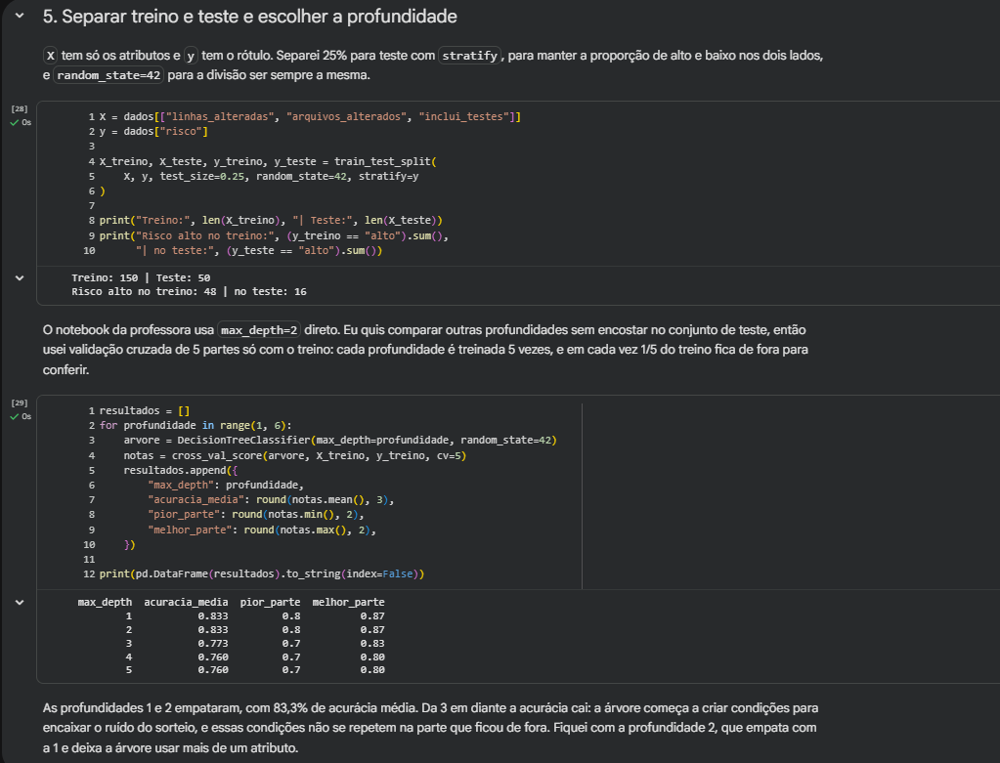
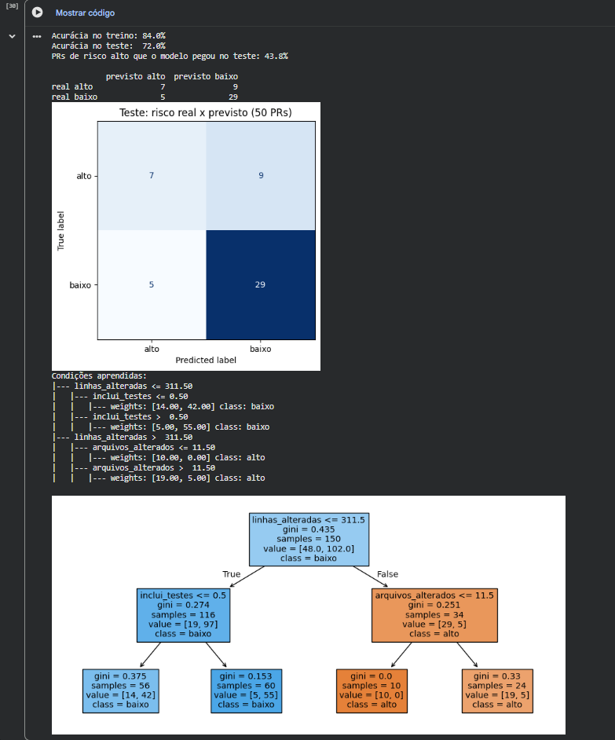
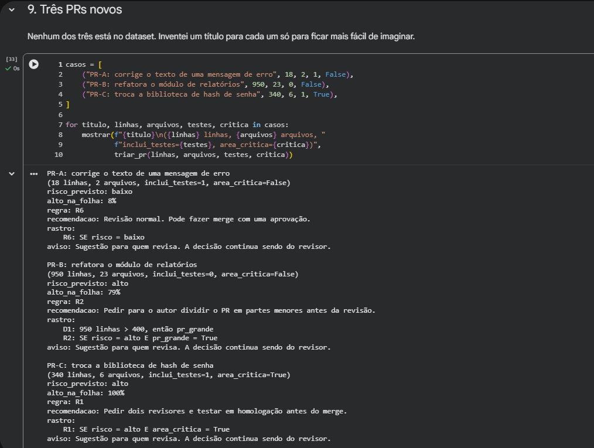
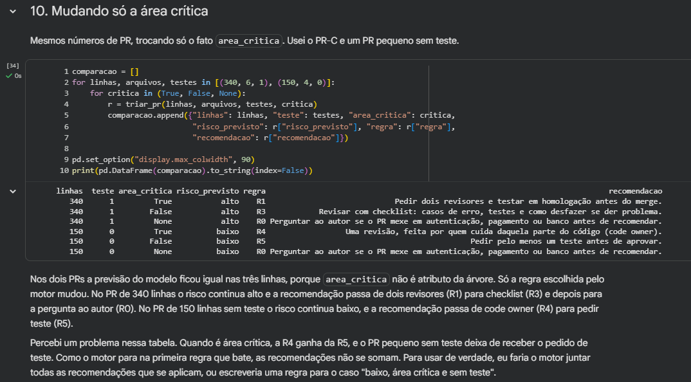
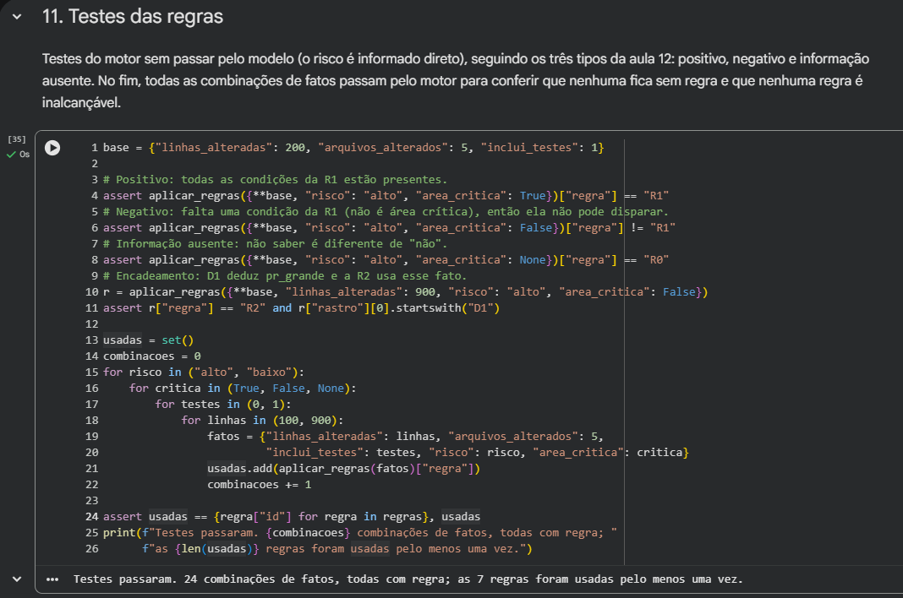

# Sistema especialista com aprendizado supervisionado: triagem de pull requests

**Estudante:** Brayan Aragão Pletsch  
**RGM:** 38473585  
**Curso/Turma:** Engenharia de Software - N1 (noturno)  
**Disciplina:** Inteligência Artificial, Linguagens Formais e Autômatos  
**Professora:** Kadidja Valéria  
**Aula:** 13 (09/11/2026), Aprendizado de máquina: introdução

## Links

- Notebook no Google Colab: [abrir no Colab](https://colab.research.google.com/drive/1fWa30sqzyK-5dhodaoRDjOn5by51pCIu?usp=sharing)
- Notebook aqui no repositório: [entrega/BrayanPletsch_Atividade_AprendizadoSupervisionado.ipynb](entrega/BrayanPletsch_Atividade_AprendizadoSupervisionado.ipynb)
- Dataset: [entrega/dataset_pull_requests.csv](entrega/dataset_pull_requests.csv)
- Script que gerou o dataset: [entrega/gerar_dataset.py](entrega/gerar_dataset.py)

Este arquivo explica o trabalho. O notebook, o dataset, o script e as capturas da execução no Colab ficam na pasta `entrega/`.

## Resumo

A professora pediu para adaptar o notebook do orientador de estudos a um problema nosso. Escolhi um da minha área: decidir quanto cuidado um pull request (PR) precisa na revisão de código.

O sistema tem duas partes. A primeira é uma árvore de decisão que olha o tamanho do PR e se ele tem teste, e prevê se o risco de dar problema depois do merge é alto ou baixo. A segunda é um sistema especialista com regras que eu escrevi: ele recebe essa previsão como um fato, junta com uma informação que o time dá na hora (se o PR mexe em parte crítica do sistema) e recomenda como revisar. A árvore é a parte que aprende com os dados, e as regras saíram de mim e das referências que usei.

## O problema

| | |
|:--|:--|
| Quem usa | quem revisa PRs em um time de desenvolvimento |
| Entradas do modelo | linhas alteradas, arquivos alterados e se o PR inclui teste (0 ou 1) |
| Rótulo previsto | `risco`: `alto` se o PR precisou de revert ou hotfix em até 14 dias depois do merge, `baixo` se não precisou |
| Fato informado na consulta | `area_critica`: o PR mexe em autenticação, pagamento ou migração de banco? Pode ser sim, não ou "ninguém sabe ainda" |
| Saída | a recomendação de revisão, a regra que foi aplicada e o rastro da inferência |

Escolhi esses atributos porque todos existem antes do merge e dá para pegar de qualquer PR pela API do GitHub.

## Dataset

Os dados são simulados, porque eu não tenho o histórico de um projeto real com a informação de quais PRs deram problema. O `gerar_dataset.py` sorteia 200 PRs com semente fixa, então rodar de novo gera o mesmo CSV. O rótulo de cada PR sai de uma chance de dar problema que eu defini: 5% para qualquer PR, mais 35% se passar de 300 linhas, mais 15% se passar de 800, mais 10% se mexer em mais de 12 arquivos e mais 40% se não tiver teste. Esses pesos são suposição minha.

O resultado foram 136 PRs de risco baixo e 64 de risco alto. Os PRs pequenos sem teste saíram com 30% de risco alto, abaixo dos 45% que coloquei no gerador, e eu comento isso no notebook como exemplo de como uma amostra pequena engana.

## Modelo

Usei uma árvore de decisão (`DecisionTreeClassifier`), com 150 PRs para treino e 50 para teste, separados com `stratify`. Em vez de fixar a profundidade, comparei de 1 a 5 com validação cruzada só no treino, para não ajustar o modelo olhando o teste. As profundidades 1 e 2 empataram e fiquei com a 2.

| Medida | Resultado |
|:--|--:|
| Acurácia no treino | 84,0% |
| Acurácia média na validação cruzada | 83,3% |
| Acurácia no teste | 72,0% |
| PRs de risco alto que o modelo pegou no teste | 7 de 16 (43,8%) |

A árvore aprendeu, na prática, que acima de 311,5 linhas o risco é alto. Os 9 PRs arriscados que ela deixou passar são todos pequenos, e 7 deles não tinham teste.

## Regras

| Regra | SE | ENTÃO |
|:--|:--|:--|
| D1 | mais de 400 linhas | o PR é grande (fato deduzido) |
| R0 | não se sabe se é área crítica | perguntar ao autor antes de recomendar |
| R1 | risco alto e área crítica | dois revisores e teste em homologação |
| R2 | risco alto e PR grande | pedir para dividir o PR |
| R3 | risco alto | revisão com checklist |
| R4 | risco baixo e área crítica | revisão de quem cuida daquela parte (code owner) |
| R5 | risco baixo e sem teste | pedir pelo menos um teste |
| R6 | risco baixo | revisão normal, merge com uma aprovação |

O motor aplica a primeira regra da lista cujas condições batem, por isso as mais específicas estão antes. A D1 roda antes de todas, e a R2 usa o fato que ela deduz (encadeamento para frente em dois passos). A R0 trata informação ausente, como na aula 12: não saber se é área crítica é diferente de saber que não é. A origem de cada regra está explicada na seção 7 do notebook.

A R5 compensa a fraqueza do modelo: dos 9 PRs arriscados que a árvore classificou como baixo, 7 recebem pelo menos o pedido de teste.

## Três casos novos

| PR | Dados | Risco previsto | Regra | Recomendação |
|:--|:--|:--|:--|:--|
| PR-A, corrige texto de mensagem de erro | 18 linhas, 2 arquivos, com teste, fora de área crítica | baixo | R6 | revisão normal |
| PR-B, refatora o módulo de relatórios | 950 linhas, 23 arquivos, sem teste, fora de área crítica | alto | D1 e R2 | dividir o PR |
| PR-C, troca a biblioteca de hash de senha | 340 linhas, 6 arquivos, com teste, área crítica | alto | R1 | dois revisores e homologação |

Na seção 10 do notebook troco só a informação de área crítica e mostro que a previsão do modelo não muda, só a regra escolhida.

## Execução no Colab

Capturas do notebook rodando no Google Colab, com Ambiente de execução > Executar tudo.

Dataset carregado do CSV, com a contagem por classe e a tabela que confere os pesos do gerador. Os PRs pequenos sem teste ficaram com 30% de risco alto.



Separação em treino e teste e validação cruzada só com o treino. As profundidades 1 e 2 empataram em 83,3%.



Avaliação no teste: 72% de acurácia, 7 dos 16 PRs de risco alto encontrados, a matriz de confusão, as condições que a árvore aprendeu e o desenho da árvore.



Os três PRs novos, cada um com a previsão, a regra aplicada e o rastro. No PR-B aparecem os dois passos do encadeamento, D1 e depois R2.



Os mesmos números de PR trocando só a área crítica. O risco previsto fica igual e só a regra muda.



Testes do motor com os casos positivo, negativo, de informação ausente e de encadeamento, mais as 24 combinações de fatos passando pelo motor.



## Limitações que encontrei

- O modelo reaprendeu a regra que eu mesmo coloquei no gerador (o corte em 311,5 linhas fica perto dos 300 do gerador). Com PRs reais não há garantia de que esse padrão exista.
- Há poucos PRs grandes no dataset: só 6 passam de 800 linhas.
- O motor para na primeira regra e não soma recomendações. Um PR pequeno, sem teste e em área crítica recebe a R4 e perde o pedido de teste da R5.
- Deixei de fora quem é o autor do PR, para o sistema não virar uma forma de avaliar pessoas.

A análise completa, com as respostas do estudo inicial e as perguntas da aula, está na seção 12 do notebook.

## Como rodar

No Colab, abrir pelo link acima e usar Ambiente de execução > Executar tudo. Se o CSV não estiver na mesma pasta, o notebook baixa o arquivo deste repositório.

No computador:

```
cd Atividades/08_AprendizadoSupervisionado/entrega
pip install pandas scikit-learn matplotlib jupyter
python gerar_dataset.py
jupyter notebook BrayanPletsch_Atividade_AprendizadoSupervisionado.ipynb
```

O `python gerar_dataset.py` só é necessário para gerar o CSV de novo, e o resultado é sempre o mesmo arquivo.
