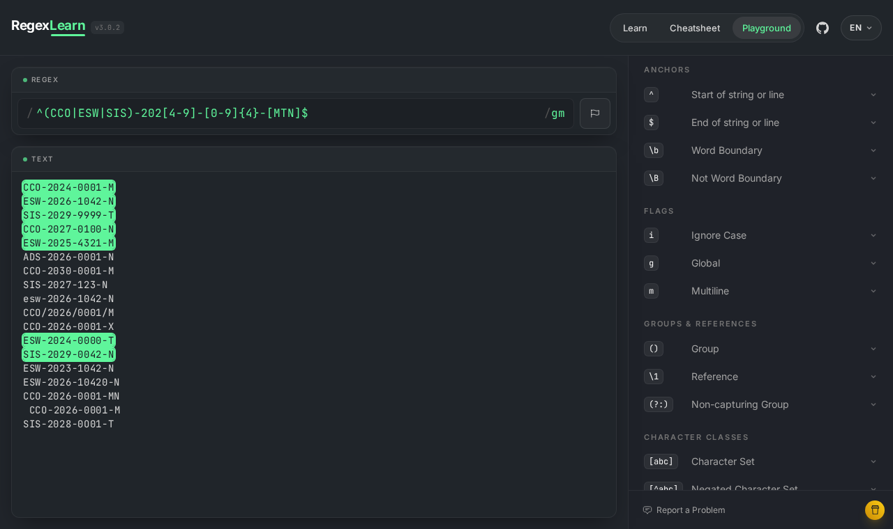
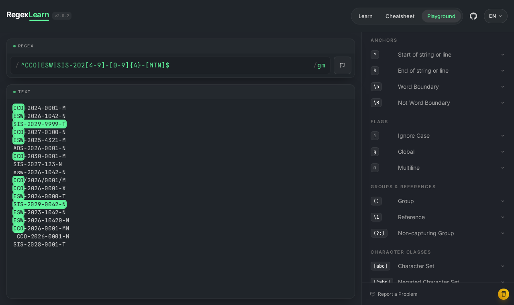
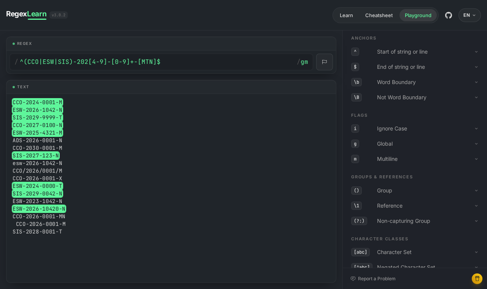
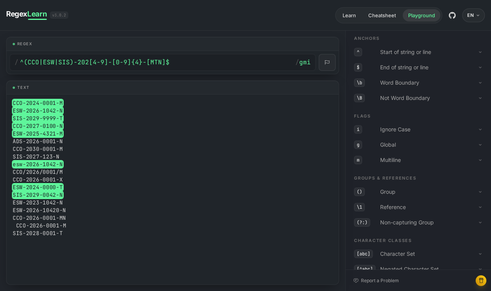

# Aula 05 — Expressões Regulares

**Estudante:** Brayan Aragão Pletsch  
**RGM:** 38473585  
**Curso/Turma:** Engenharia de Software - N1 (6º semestre, noturno)  
**Disciplina:** Linguagens Formais e Autômatos  
**Profª:** Kadidja Valéria

Arquivos desta pasta:

| Arquivo | Conteúdo |
|---|---|
| `padroes_regex.py` | todos os padrões da atividade e a função `validar(padrao, cadeia)`, que usa `re.fullmatch` |
| `validador_email.py` | programa pedido na seção 10 do tutorial de e-mail |
| `test_padroes_regex.py` | testes `unittest` com os casos do material e os casos que criei |

Para rodar os testes, dentro desta pasta: `python3 -m unittest -v test_padroes_regex` (21 testes, todos passando).

Todas as colunas "Obtido" deste documento vieram da execução dos padrões em Python 3.10 com `re.fullmatch`.

---

## 1. Exercícios guiados

### Exercício 1 — Sufixo `00`

- Alfabeto: Σ = {0, 1}.
- Blocos: um prefixo qualquer (pode ser vazio) seguido de `00` obrigatório no fim.
- A palavra mínima é `00`. A cadeia vazia e `0` ficam de fora porque não têm dois símbolos.

**Minha expressão (ER clássica):** `(0|1)*00`  
**Regex prática:** `^[01]*00$`

| Entrada | Esperado | Obtido |
|---|---|---|
| `00` | aceita | aceita |
| `100` | aceita | aceita |
| `0100` | aceita | aceita |
| `11000` | aceita | aceita |
| ε (vazia) | rejeita | rejeita |
| `0` | rejeita | rejeita |
| `10` | rejeita | rejeita |
| `001` | rejeita | rejeita |
| `1001` | rejeita | rejeita |

Além da tabela, o teste `test_sufixo_00_contra_definicao` compara a regex com `palavra.endswith("00")` para todas as 2047 palavras binárias de tamanho 0 a 10. Não houve diferença.

### Exercício 2 — Exatamente dois `a`

- Alfabeto: Σ = {a, b}.
- Os `b` podem aparecer em qualquer quantidade em três lugares: antes do primeiro `a`, entre os dois `a` e depois do segundo `a`.

**Minha expressão (ER clássica):** `b*ab*ab*`  
**Regex prática:** `^b*ab*ab*$`

| Entrada | Esperado | Obtido |
|---|---|---|
| `aa` | aceita | aceita |
| `aba` | aceita | aceita |
| `baab` | aceita | aceita |
| `bbabab` | aceita | aceita |
| ε (vazia) | rejeita | rejeita |
| `a` | rejeita | rejeita |
| `bab` | rejeita | rejeita |
| `aaa` | rejeita | rejeita |
| `ababa` | rejeita | rejeita |

O teste `test_exatamente_dois_a_contra_definicao` confere a regex contra `palavra.count("a") == 2` para todas as palavras sobre {a, b} até tamanho 9.

### Exercício 3 — Identificador acadêmico

Blocos: duas letras maiúsculas `[A-Z]{2}`, três algarismos `[0-9]{3}`, uma letra minúscula opcional `[a-z]?`. As âncoras impedem sobra antes ou depois.

**Minha expressão:** `^[A-Z]{2}[0-9]{3}[a-z]?$`

| Entrada | Esperado | Obtido | Motivo |
|---|---|---|---|
| `ES123` | aceita | aceita | sem a letra opcional |
| `LF001` | aceita | aceita | zeros à esquerda são algarismos normais |
| `AB999z` | aceita | aceita | com a letra opcional |
| `E123` | rejeita | rejeita | só uma maiúscula |
| `es123` | rejeita | rejeita | letras minúsculas no começo |
| `ES1234` | rejeita | rejeita | quatro algarismos |
| `ES123Z` | rejeita | rejeita | letra final maiúscula |
| `ES123ab` | rejeita | rejeita | duas letras no final, `?` permite no máximo uma |
| `ES-123` | rejeita | rejeita | caractere extra |

---

## 2. Desafio final — Código de matrícula acadêmica

### Produção do estudante

**Regex:**

```regex
^(CCO|ESW|SIS)-202[4-9]-[0-9]{4}-[MTN]$
```

**Justificativa por blocos:**

| Bloco da linguagem | Subexpressão | Regra atendida |
|---|---|---|
| início da entrada | `^` | 8 (nada antes) |
| CURSO ∈ C = {CCO, ESW, SIS} | `(CCO\|ESW\|SIS)` | 1 |
| hífen | `-` | 2 |
| ANO ∈ A = {2024, ..., 2029} | `202[4-9]` | 3 |
| hífen | `-` | 4 |
| NÚMERO = d1d2d3d4 | `[0-9]{4}` | 5 |
| hífen | `-` | 6 |
| TURNO ∈ T = {M, T, N} | `[MTN]` | 7 |
| fim da entrada | `$` | 8 (nada depois) |

A regex segue a descrição formal L = { c-a-d1d2d3d4-t | c ∈ C, a ∈ A, di ∈ D, t ∈ T } na mesma ordem: cada conjunto finito virou uma alternância ou uma classe, e a concatenação dos blocos é a concatenação da definição.

**Dois novos casos válidos:**

1. `ESW-2024-0000-T` (ano no limite inferior e número todo zero)
2. `SIS-2029-0042-N` (ano no limite superior)

**Dois novos casos inválidos e motivo:**

1. `ESW-2023-1042-N`: ano 2023 fica abaixo do intervalo (regra 3).
2. `ESW-2026-10420-N`: número com cinco algarismos (regra 5).

### Perguntas para justificar

**1. Qual subexpressão representa a escolha entre cursos?**  
`(CCO|ESW|SIS)`. Os parênteses limitam o alcance do `|`. Sem eles a alternância pegaria a expressão inteira, problema que mostro na seção 3.1.

**2. Como o intervalo de anos foi limitado sem aceitar `2030`?**  
Os anos válidos têm o prefixo `202` em comum e só o último dígito muda, de 4 a 9. Por isso usei `202` literal e a classe `[4-9]` para o último dígito. `2030` não começa com `202`, então falha já no terceiro caractere do ano. Também conferi todos os anos de 2000 a 2099 no teste `test_todos_os_anos`: só 2024 a 2029 passaram.

**3. Por que `{4}` é diferente de `+` no bloco numérico?**  
`[0-9]{4}` exige exatamente quatro algarismos. `[0-9]+` aceita um ou mais, o que deixaria passar `SIS-2027-123-N` (três algarismos) e `ESW-2026-10420-N` (cinco). Rodei a versão com `+` e ela aceitou `ESW-2026-10420-N`, como mostro na seção 3.1.

**4. Qual é a função das âncoras?**  
`^` e `$` obrigam a correspondência a começar no início e terminar no fim da entrada. Sem elas, uma busca acharia uma matrícula válida dentro de um texto maior, como em ` CCO-2026-0001-M` ou `CCO-2026-0001-MN`. No Python eu usei `re.fullmatch`, que já exige a cadeia inteira. Encontrei um detalhe nos testes: no Python o `$` também casa antes de uma quebra de linha final, então `re.match(MATRICULA, "CCO-2026-0001-M\n")` encontra correspondência, enquanto `re.fullmatch` rejeita (teste `test_fullmatch_rejeita_quebra_de_linha_que_o_cifrao_deixa_passar`). Esse é o motivo de eu preferir `fullmatch` na validação.

**5. Sua expressão aceita alguma cadeia que viola as regras? Como os testes sustentam a resposta?**  
Pelos testes, não. Rodei os 5 aceitos e os 6 rejeitados do material, mais 2 válidos e 6 inválidos que criei (limites de ano, quase corretos, caractere extra, letra `O` no lugar do zero e quebra de linha no fim). Também testei todos os anos de 2000 a 2099. No teste do AFD equivalente (pasta `Unidade2_GramaticasFormais/Atividades/AFD_JFLAP`), comparei a regex com o autômato em 2.370 variações de três matrículas válidas (cada posição trocada, apagada ou com um símbolo inserido) e os dois deram o mesmo resultado em todas. Teste não prova ausência de erro, mas a estrutura da regex é a mesma da definição formal bloco a bloco, e os casos de fronteira foram cobertos.

### Desafio extra — DFA equivalente

O AFD completo está em `Unidade2_GramaticasFormais/Atividades/AFD_JFLAP/afd_matricula.jff`, com definição formal e tabela de transição no relatório daquela pasta. Resumo:

```text
q0 -C-> qC -C-> qCC -O-> qCurso
q0 -E-> qE -S-> qES -W-> qCurso
q0 -S-> qS -I-> qSI -S-> qCurso
qCurso -'-'-> qH1 -2-> qA1 -0-> qA2 -2-> qA3 -[4-9]-> qAno
qAno -'-'-> qH2 -[0-9]-> qN1 -[0-9]-> qN2 -[0-9]-> qN3 -[0-9]-> qN4
qN4 -'-'-> qH3 -[MTN]-> qF
qualquer outro par (estado, símbolo) -> qerro, e qerro -> qerro com qualquer símbolo
```

- **Progresso entre os blocos:** `qCurso` marca curso completo; `qH1`, `qH2` e `qH3` marcam cada hífen lido; `qA1`, `qA2`, `qA3` e `qAno` contam os dígitos do ano; `qN1` a `qN4` contam os algarismos do número. O autômato só guarda em que bloco está e quantos símbolos daquele bloco já leu, o que é uma informação finita.
- **Ramificações:** o curso ramifica em `q0`, com três caminhos (C, E, S) que se juntam em `qCurso`. O ano só ramifica no último dígito (`qA3` vai para `qAno` com 4, 5, 6, 7, 8 ou 9). O turno ramifica em `qH3`, com M, T ou N indo para o mesmo `qF`.
- **Único estado de aceitação:** `qF`, alcançado depois do turno.
- **Caracteres adicionais:** `qF` não tem transição para nenhum símbolo, então qualquer símbolo depois do turno leva a `qerro`, que não é final e não tem saída. Foi o que aconteceu com `CCO-2026-0001-MN` (caminho `... qH3 -> qF -> qerro`).

---

## 3. Atividade prática no Regex Learn

Regex usada no [Regex Learn Playground](https://regexlearn.com/playground):

```regex
^(CCO|ESW|SIS)-202[4-9]-[0-9]{4}-[MTN]$
```

Configuração: uma cadeia por linha, com as flags `g` (global) e `m` (multiline) ligadas, para `^` e `$` valerem por linha, e a flag `i` desligada (a seção 3.1 explica o porquê).

Cadeias de teste:

```text
CCO-2024-0001-M
ESW-2026-1042-N
SIS-2029-9999-T
CCO-2027-0100-N
ESW-2025-4321-M
ADS-2026-0001-N
CCO-2030-0001-M
SIS-2027-123-N
esw-2026-1042-N
CCO/2026/0001/M
CCO-2026-0001-X
ESW-2024-0000-T
SIS-2029-0042-N
ESW-2023-1042-N
ESW-2026-10420-N
CCO-2026-0001-MN
 CCO-2026-0001-M
SIS-2028-0O01-T
```

No playground, só as 7 matrículas válidas ficaram destacadas, cada uma na linha inteira. As outras 11 não tiveram nenhum trecho marcado.



A coluna "Obtido" vale tanto para o playground quanto para o teste em Python com `re.fullmatch`; os dois deram o mesmo resultado.

### Registro dos testes

| Entrada | Esperado | Obtido | Regra verificada |
|---|---|---|---|
| `CCO-2024-0001-M` | aceita | aceita | curso, limite inferior e formato |
| `ESW-2026-1042-N` | aceita | aceita | formato geral |
| `ADS-2026-0001-N` | rejeita | rejeita | curso |
| `CCO-2030-0001-M` | rejeita | rejeita | ano |
| `ESW-2024-0000-T` (caso criado 1) | aceita | aceita | limite inferior do ano (2024) |
| `SIS-2029-0042-N` (caso criado 2) | aceita | aceita | limite superior do ano (2029) |
| `ESW-2026-10420-N` (caso criado 3) | rejeita | rejeita | quase correto: número com 5 algarismos |
| `CCO-2026-0001-MN` (caso criado 4) | rejeita | rejeita | caractere extra depois do turno |
| `SIS-2029-9999-T` | aceita | aceita | curso SIS, turno T |
| `CCO-2027-0100-N` | aceita | aceita | formato geral |
| `ESW-2025-4321-M` | aceita | aceita | formato geral |
| `SIS-2027-123-N` | rejeita | rejeita | número com 3 algarismos |
| `esw-2026-1042-N` | rejeita | rejeita | curso em minúsculas |
| `CCO/2026/0001/M` | rejeita | rejeita | separador |
| `CCO-2026-0001-X` | rejeita | rejeita | turno |
| `ESW-2023-1042-N` | rejeita | rejeita | ano logo abaixo do limite |
| ` CCO-2026-0001-M` | rejeita | rejeita | caractere extra (espaço) no início |
| `SIS-2028-0O01-T` | rejeita | rejeita | letra `O` no lugar do algarismo `0` |

### 3.1 Análise e correção de falhas

Antes da versão final, testei duas versões erradas que mostram erros da tabela da seção 7 do material. Os resultados abaixo saíram do playground e também do teste em Python (`VersoesComFalhaDaMatriculaTest`).

**Versão sem parênteses:** `^CCO|ESW|SIS-202[4-9]-[0-9]{4}-[MTN]$`

Como a alternância tem a menor precedência, essa expressão é lida como três alternativas: `^CCO`, `ESW` e `SIS-202[4-9]-[0-9]{4}-[MTN]$`. Os efeitos:

| Entrada | Busca (como o Regex Learn destaca) | Validação com `fullmatch` | Esperado |
|---|---|---|---|
| `CCO-2024-0001-M` | casa só o trecho `CCO` | rejeita | aceita |
| `SIS-2029-9999-T` | casa a linha toda | aceita | aceita |
| `CCO/2026/0001/M` | casa o trecho `CCO` | rejeita | rejeita |
| `ESW-2026-10420-N` | casa o trecho `ESW` | rejeita | rejeita |

Como o playground marca os trechos encontrados, as linhas inválidas que começam com `CCO` ou contêm `ESW` ficam marcadas, o que dá a falsa impressão de que foram aceitas. Na validação completa, a matrícula válida `CCO-2024-0001-M` é rejeitada. A regra 1 estava representada errado, porque o `|` não estava delimitado. Correção: agrupar os cursos em `(CCO|ESW|SIS)`.



**Versão com `+` no número:** `^(CCO|ESW|SIS)-202[4-9]-[0-9]+-[MTN]$`

Aceitou `ESW-2026-10420-N` (cinco algarismos) e `SIS-2027-123-N` (três), que deveriam ser rejeitadas. A regra 5 pede exatamente quatro algarismos e o `+` só garante "pelo menos um". Correção: `[0-9]{4}`.



**Flag `i` ligada no playground:** com a flag de ignorar maiúsculas e minúsculas, `esw-2026-1042-N` passa a casar. Conferi no Python com `re.IGNORECASE` e o resultado foi o mesmo. A regra pede curso em maiúsculas, então a flag tem que ficar desligada.



---

## 4. Tutorial de e-mail: atividade prática da seção 10

### 4.1 Programa

O programa `validador_email.py` faz o que a seção 10 pede:

1. pede cinco endereços com `input()`;
2. valida cada um com a Regex do tutorial, `^[A-Za-z0-9._+-]+@[A-Za-z0-9.-]+\.[A-Za-z]{2,}$`, usando `re.fullmatch`;
3. guarda os válidos e os inválidos em listas separadas;
4. mostra os dois grupos no final;
5. mostra o motivo de cada rejeição.

A Regex foi mantida exatamente como está no tutorial (o teste `test_padrao_identico_ao_do_tutorial` compara o texto). No `padroes_regex.py` ela é montada a partir de três partes, `EMAIL_USUARIO`, `EMAIL_DOMINIO` e `EMAIL_EXTENSAO`, porque a função que explica a rejeição precisa testar cada parte separadamente. Assim as classes de caracteres ficam escritas num lugar só.

Para explicar o motivo, a função `motivos_rejeicao` divide o endereço no `@` e no último ponto. Isso reproduz exatamente as partes que a Regex tenta casar: a extensão `[A-Za-z]{2,}` não tem ponto, então ela é sempre o trecho depois do último ponto. O teste `test_sem_motivo_somente_quando_a_regex_aceita` confere, em 2.662 entradas geradas a partir de pedaços válidos e inválidos, que a função só devolve lista vazia quando a Regex aceita.

Execução com os cinco casos mínimos da seção 10 (comando `python3 validador_email.py`, entradas digitadas uma por linha):

```text
E-mail 1: maria@gmail.com
E-mail 2: joao.silva@udf.edu.br
E-mail 3: estudante_01@faculdade.com
E-mail 4: pedro.gmail.com
E-mail 5: ana@dominio

Formatos válidos (3):
  maria@gmail.com
  joao.silva@udf.edu.br
  estudante_01@faculdade.com

Formatos inválidos (2):
  pedro.gmail.com: não possui o símbolo @
  ana@dominio: não possui extensão (falta o ponto depois do domínio)
```

Por que cada inválido foi rejeitado:

- `pedro.gmail.com`: a Regex tem `@` literal obrigatório entre o usuário e o domínio. Sem ele, não existe forma de dividir a cadeia nos blocos USUÁRIO · @ · DOMÍNIO · . · EXTENSÃO.
- `ana@dominio`: depois do `@` a Regex exige `\.` seguido de pelo menos duas letras. `dominio` não tem ponto, então falta o bloco da extensão.

### 4.2 Tabela de testes da seção 5

| Entrada | Esperado | Obtido | Motivo devolvido pelo programa |
|---|---|---|---|
| `aluno@gmail.com` | válido | válido | |
| `nome.sobrenome@udf.edu.br` | válido | válido | |
| `estudante_01@faculdade.com` | válido | válido | |
| `contato+curso@exemplo.com.br` | válido | válido | |
| `aluno.gmail.com` | inválido | inválido | não possui o símbolo @ |
| `aluno@` | inválido | inválido | não possui domínio depois do @ |
| `@gmail.com` | inválido | inválido | não possui usuário antes do @ |
| `aluno@gmail` | inválido | inválido | não possui extensão (falta o ponto depois do domínio) |
| `aluno@gmail.c` | inválido | inválido | a extensão precisa ter pelo menos duas letras e só letras |
| `aluno gmail.com` | inválido | inválido | contém espaço em branco; não possui o símbolo @ |

### 4.3 Desafio: Regex aprimorada

O desafio pede para impedir ponto no início do usuário, ponto logo antes do `@`, dois pontos seguidos e hífen no início ou no fim de uma parte do domínio. A Regex do tutorial aceita todos esses casos, porque o ponto e o hífen estão na mesma classe dos outros caracteres e podem aparecer em qualquer posição.

Minha versão:

```regex
^[A-Za-z0-9_+-]+(?:\.[A-Za-z0-9_+-]+)*@(?:[A-Za-z0-9](?:[A-Za-z0-9-]*[A-Za-z0-9])?\.)+[A-Za-z]{2,}$
```

Por blocos:

| Bloco | Subexpressão | O que resolve |
|---|---|---|
| usuário | `[A-Za-z0-9_+-]+(?:\.[A-Za-z0-9_+-]+)*` | o ponto saiu da classe e só entra seguido de pelo menos um caractere. Assim o usuário não começa nem termina com ponto e não tem `..` |
| `@` | `@` | igual ao tutorial |
| partes do domínio | `(?:[A-Za-z0-9](?:[A-Za-z0-9-]*[A-Za-z0-9])?\.)+` | cada parte começa e termina com letra ou número e o hífen só aparece no meio. Cada parte termina com seu próprio ponto, o que também impede `..` no domínio |
| extensão | `[A-Za-z]{2,}` | igual ao tutorial |

`(?: ... )` é um grupo sem captura. Ele funciona como os parênteses comuns para o `*` e o `+`, só não guarda o trecho casado. Continua sendo uma expressão regular no sentido formal: só usa concatenação, união, repetição e classes.

| Entrada | Regex do tutorial | Regex aprimorada |
|---|---|---|
| `nome.sobrenome@udf.edu.br` | aceita | aceita |
| `contato+curso@exemplo.com.br` | aceita | aceita |
| `ana@minha-instituicao.com` | aceita | aceita |
| `.ana@udf.edu.br` | aceita | rejeita |
| `ana.@udf.edu.br` | aceita | rejeita |
| `ana..silva@udf.edu.br` | aceita | rejeita |
| `ana@udf..edu.br` | aceita | rejeita |
| `ana@-udf.edu.br` | aceita | rejeita |
| `ana@udf-.edu.br` | aceita | rejeita |
| `aluno@gmail.c` | rejeita | rejeita |

As duas Regex verificam só o formato. A seção 9 do tutorial, "Limitações importantes", lembra que elas não garantem que o endereço exista, que o domínio esteja registrado, que a caixa esteja ativa nem que todas as regras técnicas internacionais de e-mail sejam atendidas. Encontrei dois exemplos práticos disso:

- O slide "A Estrutura de um E-mail" (Entendendo Regex) usa uma variante com `%` na classe do usuário. Com a Regex do tutorial, `ana%teste@udf.edu.br` é rejeitado. As duas versões do material não descrevem a mesma linguagem, e endereços com caracteres menos comuns acabam recusados.
- A minha versão aprimorada também deixa passar casos estranhos, como `-ana@udf.edu.br` e `ana_@udf.edu.br`, porque o desafio só pediu regras para o ponto no usuário e para o hífen no domínio. Fechar mais a Regex esbarraria no aviso do próprio tutorial de não deixar a validação rígida demais.

Por isso a confirmação de verdade continua sendo a que o tutorial recomenda: mandar uma mensagem com link ou código de verificação. Também vale lembrar o que a seção 7 fala sobre o atributo `pattern` no HTML: ele ajuda no navegador, mas o servidor precisa validar de novo.

---

## 5. Perguntas de reflexão

**1. Toda expressão regular formal representa uma linguagem regular?**  
Sim. A definição clássica só tem ∅, ε, símbolos, união, concatenação e estrela, e as linguagens regulares são fechadas por essas três operações. Pela construção de Thompson toda ER formal vira um ε-NFA, e todo NFA reconhece uma linguagem regular. O cuidado é com "Regex" de motor: retroreferências como `(a*)b\1` descrevem {aⁿbaⁿ}, que não é regular.

**2. Toda linguagem regular pode ser representada por uma expressão regular?**  
Sim, essa é a outra metade do Teorema de Kleene. Dado um autômato finito que reconhece a linguagem, dá para obter uma ER eliminando estados e juntando os rótulos das transições em expressões cada vez maiores.

**3. Qual é a relação entre uma ER, um NFA e um DFA?**  
Os três descrevem exatamente a mesma classe, as linguagens regulares. O caminho usual é ER → ε-NFA (Thompson) → DFA (construção dos subconjuntos) → DFA mínimo. A ER descreve, o NFA é mais fácil de montar a partir da ER, e o DFA é o que executa sem precisar tentar vários caminhos ao mesmo tempo. No desafio da matrícula, a regex e o AFD que montei deram o mesmo resultado em todos os testes.

**4. Qual é a diferença entre uma expressão regular teórica e as extensões de motores de programação?**  
A teórica serve para denotar uma linguagem e só tem os operadores básicos. Os motores acrescentam classes, quantificadores, âncoras, grupos, flags e às vezes retroreferências e recursão. Classes e quantificadores são só abreviações (`[0-9]{4}` é `(0|1|...|9)` repetido quatro vezes), mas retroreferência muda o poder da expressão. Na prática também muda a semântica de execução: `re.search` procura um trecho, `re.fullmatch` exige a cadeia toda, e o `$` do Python casa antes de um `\n` final, coisa que não existe na teoria.

**5. Por que um autômato finito reconhece paridade, mas não consegue contar arbitrariamente e comparar duas quantidades sem limite?**  
Para paridade basta lembrar "par" ou "ímpar", dois estados, como no exemplo `0*(10*10*)*` da quantidade par de `1`. Para comparar duas quantidades sem limite, o autômato teria que lembrar quantos símbolos leu, e esse número pode ser qualquer natural. Com k estados ele só distingue k situações, então em algum momento duas contagens diferentes caem no mesmo estado e o autômato não tem como diferenciá-las.

**6. Por que {aⁿbⁿ | n ≥ 0} não é regular?**  
Suponha um DFA com k estados que reconheça a linguagem. Ao ler a⁰, a¹, ..., aᵏ (k+1 prefixos), dois deles, aⁱ e aʲ com i ≠ j, terminam no mesmo estado. Como aⁱbⁱ é aceita, a partir daquele estado a leitura de bⁱ chega a um estado final. Então aʲbⁱ também seria aceita, mas i ≠ j. Contradição. É o argumento da casa dos pombos que está por trás do lema do bombeamento.

**7. O que muda ao passarmos de linguagens regulares para linguagens livres de contexto?**  
Entra uma memória sem limite na forma de pilha. O autômato de pilha empilha um símbolo para cada `a` e desempilha um para cada `b`, e aceita aⁿbⁿ quando a pilha esvazia no fim. Do lado das gramáticas, saímos das regras regulares (A → aB ou A → a) para regras como S → aSb | ε, em que o lado direito pode ter variáveis no meio. É o tipo de estrutura de parênteses balanceados e blocos aninhados que aparece nos compiladores.
