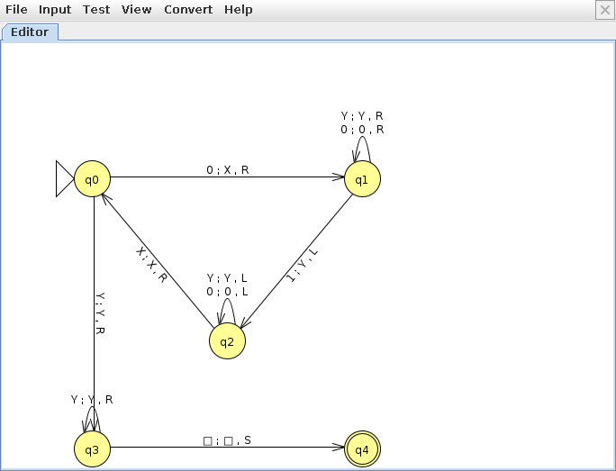
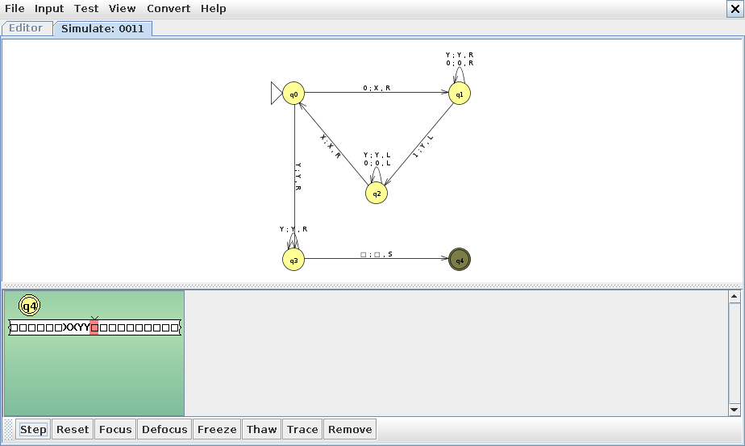
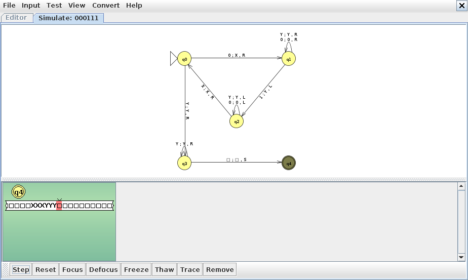
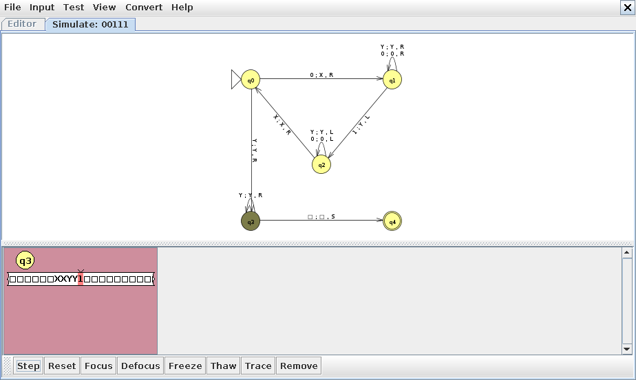
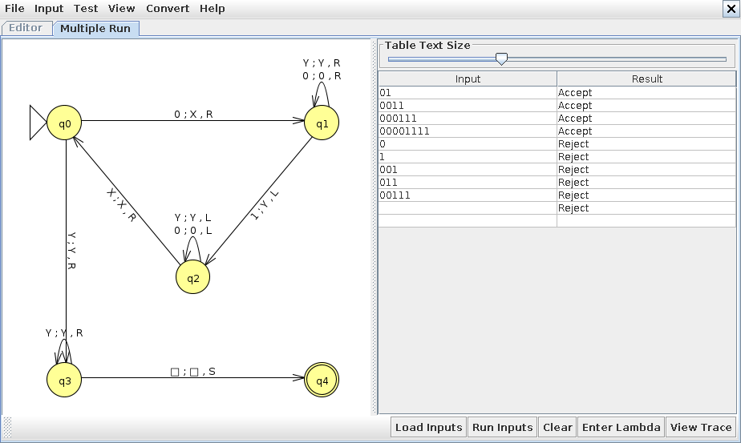

# Atividade Remota: Máquinas de Turing (Aula 09)

Brayan Aragão Pletsch | RGM 38473585 | Engenharia de Software - N1

Teoria da Computação | Profª Kadidja Valéria | Aula 09 (28/09/2026) | Valor: 1,0 ponto

Material indicado: vídeo Akitando #86, "O Computador de Turing e Von Neumann: Por que calculadoras não são computadores?".

Arquivos que acompanham esta entrega, na pasta `MaquinasDeTuring/` do meu repositório:

- `maquina_0n1n.jff`: a máquina construída no JFLAP;
- `simulador_mt.py`: simulador em Python que lê o mesmo `.jff` e imprime cada configuração da execução;
- `test_simulador_mt.py`: testes automatizados com as palavras do enunciado.
- `capturas/`: as capturas de tela do JFLAP usadas neste documento.

## Etapa 1 — Introdução

### 1. O que é uma Máquina de Turing?

É um modelo matemático de computação proposto por Alan Turing em 1936. A máquina tem uma fita dividida em células, uma cabeça que lê e escreve um símbolo por vez e um controle com um número finito de estados. Em cada passo ela olha duas coisas, o estado atual e o símbolo que está embaixo da cabeça, e uma regra fixa diz o que escrever naquela célula, para que lado mover a cabeça e qual será o próximo estado. Quando não existe regra para a situação atual, a máquina para. Se parou em um estado de aceitação, a palavra de entrada é aceita.

Comparando com o AFD da Aula 04: o autômato finito lê a entrada uma vez, da esquerda para a direita, e a única "memória" que ele tem é o estado em que está. A Máquina de Turing pode voltar na fita, apagar e reescrever o que já leu, e a fita não tem limite. Por isso o material da disciplina a coloca como o modelo mais poderoso de autômato, com uma fita infinita que funciona como memória (Yasuda; Souza, 2024).

### 2. Quais são os principais componentes de uma Máquina de Turing?

Formalmente, $M = (Q, \Sigma, \Gamma, \delta, q_0, \square, F)$. Na prática:

- Fita: sequência ilimitada de células. No início ela contém a palavra de entrada e todas as outras células têm o símbolo branco ($\square$).
- Cabeça de leitura e escrita: aponta para uma célula. Lê o símbolo, escreve outro (ou o mesmo) e se move uma posição para a esquerda (L) ou para a direita (R). O JFLAP também permite ficar parado (S).
- Conjunto finito de estados $Q$, com um estado inicial $q_0$ e um conjunto de estados de aceitação $F$.
- Alfabeto de entrada $\Sigma$ e alfabeto da fita $\Gamma$. O alfabeto da fita contém o de entrada, o branco e símbolos auxiliares que a máquina usa para marcar posições. Na minha máquina, $\Sigma = \{0, 1\}$ e $\Gamma = \{0, 1, X, Y, \square\}$.
- Função de transição $\delta(q, a) = (p, b, D)$: no estado $q$ lendo $a$, escreve $b$, move na direção $D$ e vai para o estado $p$. É o "programa" da máquina.

É a mesma ideia da gramática $G = (V, T, P, S)$ da Aula 03: uma estrutura pequena e bem definida que, junto com as regras, descreve uma linguagem inteira.

### 3. Qual é a importância das Máquinas de Turing para a computação?

Antes de 1936, "procedimento mecânico" ou "algoritmo" era uma ideia intuitiva. A Máquina de Turing deu uma definição precisa para isso, e com uma definição precisa passou a ser possível provar coisas sobre o que pode e o que não pode ser computado (Turing, 1936).

A Tese de Church-Turing diz que tudo que pode ser calculado por um procedimento efetivo pode ser calculado por uma Máquina de Turing. Isso vale para qualquer linguagem de programação de uso geral: Python, C e Java mudam a conveniência e a velocidade, mas o conjunto de funções que conseguem calcular é o mesmo. Quando dizemos que uma linguagem é "Turing completa", é essa equivalência que está sendo afirmada.

Outro ponto é a máquina universal: uma Máquina de Turing pode receber na fita a descrição de outra máquina e simular essa outra máquina. O programa vira um dado como qualquer outro. É essa a ideia do computador de programa armazenado, e o título do vídeo indicado faz justamente a ligação entre Turing, Von Neumann e a diferença entre computador e calculadora. Uma calculadora simples executa um conjunto fixo de operações. Um computador executa qualquer programa que for carregado na memória.

Por fim, na Hierarquia de Chomsky vista na Aula 03, a Máquina de Turing corresponde às gramáticas Tipo 0 (irrestritas), que estão no topo da hierarquia. O autômato finito fica nas regulares (Tipo 3) e o autômato de pilha nas livres de contexto (Tipo 2).

### 4. Qual é a relação entre Máquina de Turing e algoritmo?

Um algoritmo é uma sequência finita de passos bem definidos que termina com uma resposta. A Máquina de Turing é a versão formal disso: cada passo é uma transição, "bem definido" quer dizer que a função de transição não deixa dúvida sobre o que fazer, e "termina" quer dizer que a máquina para. Pela Tese de Church-Turing, dizer que existe um algoritmo para um problema é o mesmo que dizer que existe uma Máquina de Turing que para em toda entrada com a resposta certa.

A máquina da Etapa 2 mostra isso em pequena escala. O algoritmo que pensei em português foi "marca um 0, procura o primeiro 1 e marca também, volta e repete; no fim confere se não sobrou nada". A tabela de transições é esse mesmo algoritmo, escrito em uma linguagem que a máquina executa sem precisar interpretar nada. A relação também funciona ao contrário: o simulador em Python que escrevi executa a Máquina de Turing, e uma Máquina de Turing, com bastante paciência, conseguiria simular o programa em Python.

## Etapa 2 — Simulação

Software: JFLAP 7.1, tipo Turing Machine, uma fita. Arquivo: `maquina_0n1n.jff`.

Linguagem reconhecida: $L = \{0^n1^n \mid n \geq 1\}$.

Sobre a cadeia vazia: o enunciado não diz explicitamente se $n$ começa em 0 ou em 1, mas o menor exemplo aceito é `01`. Considerei $n \geq 1$, então a máquina rejeita $\varepsilon$ (ela para em $q_0$ lendo branco). Se a intenção for $n \geq 0$, basta acrescentar a transição $\delta(q_0, \square) = (q_4, \square, S)$. Ela não muda nenhum outro caso, porque $q_0$ só lê branco quando a fita começa vazia.

Esta linguagem não é regular. Para aceitar `000111` e rejeitar `00111`, a máquina precisa lembrar quantos 0 leu, e um AFD com um número fixo de estados não consegue contar até um valor sem limite. Aqui quem guarda essa contagem é a própria fita: cada 0 marcado com X tem que ter um 1 marcado com Y correspondente.

### Funcionamento

A máquina trabalha em rodadas. Em cada rodada ela marca o 0 mais à esquerda com X e o primeiro 1 ainda não marcado com Y. Quando não sobra 0, ela confere se também não sobrou 1.

- $q_0$ (início de cada rodada): se lê 0, troca por X e vai procurar um 1. Se lê Y, todos os 0 já foram marcados e a máquina vai para a conferência final.
- $q_1$ (procura o 1): anda para a direita passando por 0 e Y. No primeiro 1, troca por Y e começa a voltar. Se chegar ao branco sem achar 1, existem mais 0 do que 1 e a máquina para.
- $q_2$ (volta): anda para a esquerda passando por 0 e Y até encontrar o X mais à direita. Dá um passo para a direita e volta para $q_0$.
- $q_3$ (conferência): anda para a direita sobre os Y. Se chegar ao branco, a quantidade bate e vai para $q_4$. Se encontrar um 1, existem mais 1 do que 0 e a máquina para.
- $q_4$: estado de aceitação.

O JFLAP não tem um estado de rejeição separado. A máquina rejeita quando para em um estado que não é final por falta de transição. Isso também cuida da ordem dos símbolos: `10` para logo em $q_0$ lendo 1, e `0101` para em $q_1$, que não tem transição para X. Por isso a máquina conta e também exige que todos os 0 venham antes dos 1.

### Tabela de transições

Notação: `símbolo escrito, movimento, próximo estado`. O traço `-` indica que não existe transição: a máquina para ali e, como nenhum desses estados é final, rejeita.

| Estado | Lê 0 | Lê 1 | Lê X | Lê Y | Lê $\square$ |
|---|---|---|---|---|---|
| $\to q_0$ | X, R, $q_1$ | - | - | Y, R, $q_3$ | - |
| $q_1$ | 0, R, $q_1$ | Y, L, $q_2$ | - | Y, R, $q_1$ | - |
| $q_2$ | 0, L, $q_2$ | - | X, R, $q_0$ | Y, L, $q_2$ | - |
| $q_3$ | - | - | - | Y, R, $q_3$ | $\square$, S, $q_4$ |
| $* q_4$ | - | - | - | - | - |

No editor do JFLAP os rótulos aparecem no formato `lido ; escrito , movimento`, por exemplo `0 ; X , R` na seta de $q_0$ para $q_1$. São 10 transições ao todo.

### Diagrama no JFLAP



## Etapa 3 — Registro da simulação

Rodei os testes no JFLAP 7.1 (capturas mais abaixo). A lista de estados percorridos veio do simulador em Python, que lê o mesmo arquivo `.jff` e imprime cada configuração; o resultado final dele bateu com o do JFLAP em todas as entradas. A sequência de estados abaixo inclui o estado inicial e o estado em que a máquina parou.

### Registro dos testes

| Teste | Entrada | Resultado esperado | Resultado obtido | Estados percorridos |
|---|---|---|---|---|
| 1 | 0011 | ACEITA | ACEITA | q0, q1, q1, q2, q2, q0, q1, q1, q2, q2, q0, q3, q3, q4 (13 transições) |
| 2 | 000111 | ACEITA | ACEITA | q0, q1, q1, q1, q2, q2, q2, q0, q1, q1, q1, q2, q2, q2, q0, q1, q1, q1, q2, q2, q2, q0, q3, q3, q3, q4 (25 transições) |
| 3 | 00111 | REJEITA | REJEITA | q0, q1, q1, q2, q2, q0, q1, q1, q2, q2, q0, q3, q3; parou em q3 lendo 1 (12 transições) |

### Configurações passo a passo

Cada linha mostra o passo, o estado e o conteúdo da fita. O símbolo entre colchetes é o que está embaixo da cabeça.

Teste 1, entrada `0011`:

```text
  0  q0  [0]011
  1  q1  X[0]11
  2  q1  X0[1]1
  3  q2  X[0]Y1
  4  q2  [X]0Y1
  5  q0  X[0]Y1
  6  q1  XX[Y]1
  7  q1  XXY[1]
  8  q2  XX[Y]Y
  9  q2  X[X]YY
 10  q0  XX[Y]Y
 11  q3  XXY[Y]
 12  q3  XXYY[□]
 13  q4  XXYY[□]   ACEITA
```

Teste 2, entrada `000111`:

```text
  0  q0  [0]00111
  1  q1  X[0]0111
  2  q1  X0[0]111
  3  q1  X00[1]11
  4  q2  X0[0]Y11
  5  q2  X[0]0Y11
  6  q2  [X]00Y11
  7  q0  X[0]0Y11
  8  q1  XX[0]Y11
  9  q1  XX0[Y]11
 10  q1  XX0Y[1]1
 11  q2  XX0[Y]Y1
 12  q2  XX[0]YY1
 13  q2  X[X]0YY1
 14  q0  XX[0]YY1
 15  q1  XXX[Y]Y1
 16  q1  XXXY[Y]1
 17  q1  XXXYY[1]
 18  q2  XXXY[Y]Y
 19  q2  XXX[Y]YY
 20  q2  XX[X]YYY
 21  q0  XXX[Y]YY
 22  q3  XXXY[Y]Y
 23  q3  XXXYY[Y]
 24  q3  XXXYYY[□]
 25  q4  XXXYYY[□]   ACEITA
```

Teste 3, entrada `00111`:

```text
  0  q0  [0]0111
  1  q1  X[0]111
  2  q1  X0[1]11
  3  q2  X[0]Y11
  4  q2  [X]0Y11
  5  q0  X[0]Y11
  6  q1  XX[Y]11
  7  q1  XXY[1]1
  8  q2  XX[Y]Y1
  9  q2  X[X]YY1
 10  q0  XX[Y]Y1
 11  q3  XXY[Y]1
 12  q3  XXYY[1]   REJEITA (q3 não tem transição lendo 1)
```

### Demais exemplos do enunciado

| Entrada | Esperado | Obtido | Estados percorridos | Onde parou |
|---|---|---|---|---|
| 01 | ACEITA | ACEITA | q0, q1, q2, q0, q3, q4 | $q_4$ (final) |
| 00001111 | ACEITA | ACEITA | 4 rodadas de q0, q1, ..., q2; depois q0, q3, q3, q3, q3, q4 (41 transições) | $q_4$ (final) |
| 0 | REJEITA | REJEITA | q0, q1 | $q_1$ lendo $\square$: faltou um 1 |
| 1 | REJEITA | REJEITA | q0 | $q_0$ lendo 1: a palavra começa com 1 |
| 001 | REJEITA | REJEITA | q0, q1, q1, q2, q2, q0, q1, q1 | $q_1$ lendo $\square$: sobrou um 0 sem par |
| 011 | REJEITA | REJEITA | q0, q1, q2, q0, q3 | $q_3$ lendo 1: sobrou um 1 sem par |
| $\varepsilon$ (vazia) | REJEITA | REJEITA | q0 | $q_0$ lendo $\square$ ($n \geq 1$) |

Além desses, os testes automatizados (`python3 -m unittest discover -s MaquinasDeTuring`) rodam a máquina em todas as 2047 palavras sobre $\{0, 1\}$ com até 10 símbolos e comparam com a definição de $0^n1^n$. Todas deram o resultado esperado, inclusive casos com a mesma quantidade de símbolos fora de ordem, como `10`, `0101` e `0110`.

### Capturas de tela da simulação

Teste 1, `0011`, executado com Input > Step até o fim. A configuração ficou verde (aceita) em $q_4$, com a fita `XXYY`.



Teste 2, `000111`: aceita em $q_4$, com a fita `XXXYYY`.



Teste 3, `00111`: a máquina para em $q_3$ lendo `1`, sem transição, e o JFLAP marca a configuração em vermelho (rejeitada).



Input > Multiple Run com todos os exemplos do enunciado e a cadeia vazia (última linha):



### Interpretação dos resultados

Os três testes obrigatórios e os demais exemplos tiveram o resultado esperado. Nas rejeições, o estado em que a máquina para já diz o motivo: parar em $q_1$ lendo branco significa que um 0 ficou sem 1 para formar par (`0`, `001`), parar em $q_3$ lendo 1 significa que sobrou 1 depois de todos os 0 serem marcados (`011`, `00111`) e parar em $q_0$ lendo 1 significa que a palavra começou com 1.

O número de passos cresce rápido. Foram 5 transições para `01`, 13 para `0011`, 25 para `000111` e 41 para `00001111`, o que bate com $2n^2 + 2n + 1$. A cabeça vai e volta pela fita uma vez para cada par, então o custo é quadrático em $n$. Um autômato de pilha resolveria a mesma linguagem lendo a palavra uma única vez. Para esta linguagem a Máquina de Turing gasta mais passos, e a vantagem dela aparece em linguagens que nenhum autômato de pilha reconhece.

## Etapa 4 — Reflexão sobre os limites computacionais

Não. A Máquina de Turing executa qualquer algoritmo, mas existem problemas para os quais nenhum algoritmo existe. O exemplo clássico é o problema da parada: dado um programa e uma entrada, dizer se ele termina ou roda para sempre. Turing mostrou por contradição que isso é impossível. Se existisse uma máquina H que sempre acertasse, daria para montar uma máquina D que consulta H sobre si mesma e faz o contrário do que H previu. D rodando com a própria descrição não tem resposta consistente, então H não pode existir. Outro argumento é de quantidade: cada Máquina de Turing é uma descrição finita e dá para numerá-las, mas existem mais problemas do que máquinas. Meu simulador esbarra nesse limite: ele desiste depois de 10.000 passos, porque não há como saber, em geral, se a máquina pararia mais adiante.

## Questão final

> Como saber se um problema é apenas difícil de resolver ou se não existe nenhum algoritmo capaz de resolvê-lo para todos os casos?

Primeiro separo os dois conceitos. Um problema difícil é decidível: existe uma Máquina de Turing que sempre para com a resposta certa, só que ela pode levar um tempo enorme. Testar todas as rotas no problema do caixeiro viajante é um exemplo. A quantidade de rotas é finita, então a força bruta sempre termina, mesmo que demore anos para muitas cidades. Um problema indecidível é aquele para o qual não existe máquina que pare em todas as entradas com a resposta certa. Mais processador ou mais memória não muda nada nesse caso.

Observar a execução não resolve a dúvida. Se um programa está rodando há uma hora, eu não sei se ele está perto de terminar ou se está em laço infinito, que é exatamente o problema da parada. A resposta precisa sair de um argumento sobre o problema:

1. Procuro um algoritmo que sempre termine, mesmo que seja lento. Se o espaço de possibilidades é finito (ou dá para limitar) e cada candidato pode ser verificado, a força bruta já prova que o problema é decidível. Aí a pergunta passa a ser de complexidade: existe algo melhor que exponencial?
2. Se não encontro nenhum limite para a busca, desconfio de indecidibilidade e tento uma redução: mostrar que, se eu tivesse um algoritmo para o meu problema, conseguiria usá-lo para resolver o problema da parada. Como o problema da parada não tem solução, o meu também não tem.

Um exemplo próximo da Engenharia de Software: uma ferramenta que recebesse qualquer programa e dissesse com certeza se ele pode lançar uma exceção, ou se duas funções retornam sempre o mesmo valor. Com essa ferramenta eu resolveria a parada: bastaria montar um programa que executa o programa suspeito e lança uma exceção logo depois. Ele só lança a exceção se o programa suspeito terminar. Então essa ferramenta não pode existir para todos os programas. O Teorema de Rice generaliza isso: qualquer propriedade não trivial sobre o comportamento de programas é indecidível. É por isso que analisadores estáticos e linters trabalham com aproximações. Eles aceitam falsos positivos ou se restringem a um subconjunto da linguagem.

Há um meio termo que vale lembrar: o problema da parada é semidecidível. Se o programa para, simulando eu acabo descobrindo. Se ele não para, a simulação nunca me dá a resposta. É o comportamento do simulador que escrevi para esta atividade.

## Referências

AKITA, Fabio. Akitando #86: O Computador de Turing e Von Neumann, por que calculadoras não são computadores? AkitaOnRails.com, 23 out. 2020. Disponível em: https://akitaonrails.com/2020/10/23/akitando-86-o-computador-de-turing-e-von-neumann-por-que-calculadoras-nao-sao-computadores/. Material indicado no enunciado.

JFLAP Home Page. Disponível em: http://www.jflap.org/. Software usado na simulação (versão 7.1).

TURING, A. M. On Computable Numbers, with an Application to the Entscheidungsproblem. Proceedings of the London Mathematical Society, v. 42, p. 230-265, 1936.

OLIVEIRA, Kadidja Valéria Reginaldo de. Gramáticas Formais. Slides da Aula 03 da disciplina Inteligência Artificial, Linguagens Formais e Autômatos. Brasília: Centro Universitário UDF, 2026.

YASUDA, E. S.; SOUZA, J. P. R. Ilhas do Sábio: a busca pelo tesouro escondido. Trabalho de Conclusão de Curso (Ciência da Computação), Centro Universitário do Distrito Federal (UDF), Brasília, 2024. Material disponibilizado na disciplina.
