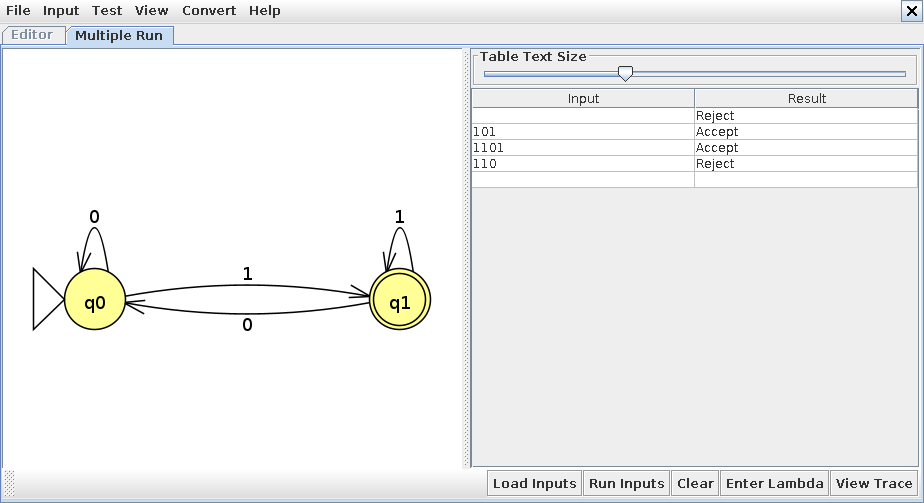
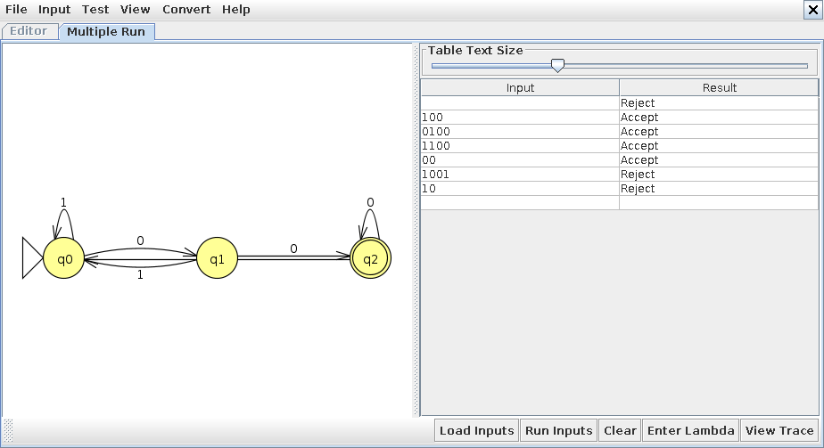
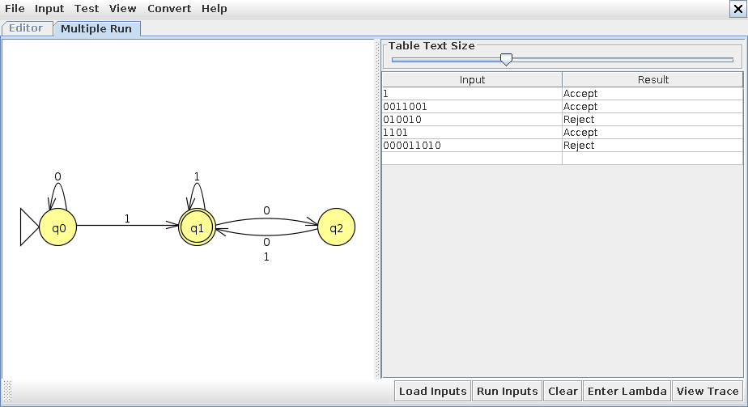
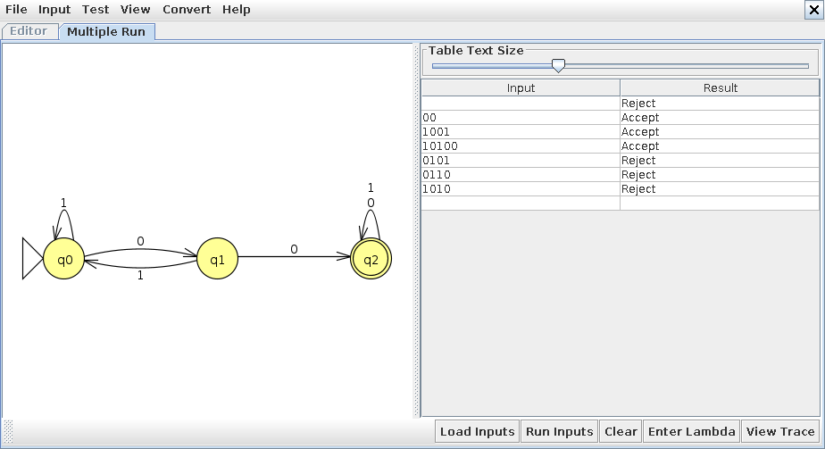
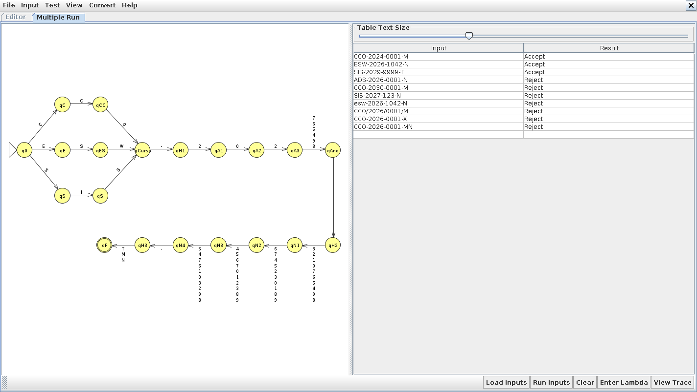

# Exercícios sobre AFD (Autômato Finito Determinístico) no JFLAP

**Estudante:** Brayan Aragão Pletsch  
**RGM:** 38473585  
**Curso/Turma:** Engenharia de Software - N1  
**Disciplina:** Linguagens Formais e Autômatos  
**Profª:** Kadidja Valéria

## Sobre o enunciado

A atividade de 31/08 consta como pendente em `AtividadesUnidade2.md`, e a lista oficial com os exercícios do JFLAP não foi publicada no repositório nem no material da disciplina. O último slide da "Aula 5: Autômatos Finitos Determinísticos (AFD) – Parte 1" pede para resolver a "lista de exercícios 2", que também não está disponível. Por isso resolvi os exercícios de AFD que os próprios slides propõem e o desafio do DFA equivalente do material de Expressões Regulares:

| Nº | Origem | Linguagem | Arquivo JFLAP |
|---|---|---|---|
| 1 | Aula 04, slide "Arquitetando a Solução" | palavras binárias que terminam em 1 | `afd_termina_em_1.jff` |
| 2 | Aula 04, slide "Atividade Prática — Construção de Autômato" | palavras binárias que terminam com 00 | `afd_termina_em_00.jff` |
| 3 | Aula 5, slide "Exemplo Prático 1: Verificação de Cadeias" | AFD dado no slide, verificar cinco cadeias | `afd_exemplo_pratico_1.jff` |
| 4 | Aula 5, slide "Síntese e Exemplo 2 (Modelagem JFLAP)" | palavras binárias com pelo menos dois 0 consecutivos | `afd_dois_zeros_consecutivos.jff` |
| 5 | Material de Expressões Regulares, "Desafio extra — DFA equivalente" | códigos de matrícula `CURSO-ANO-NÚMERO-TURNO` | `afd_matricula.jff` |

Os arquivos `.jff` estão no formato do JFLAP 7 (`<type>fa</type>`) e abrem em File > Open. No JFLAP, as cadeias podem ser conferidas de uma vez em Input > Multiple Run.

Nas tabelas de transição sigo a notação do slide "Visão em Tabela": `→` marca o estado inicial e `*` marca os estados finais.

Os caminhos de estados das tabelas foram gerados com o `simulador_afd.py`, que lê o `.jff` (seção 7). Rodei as mesmas cadeias no JFLAP 7.1 com Input > Multiple Run e o resultado (Accept/Reject) foi igual em todas; as capturas estão na seção 6.

---

## 1. Palavras que terminam em 1

L₁ = { w ∈ {0,1}* | w termina em 1 }

A máquina só precisa lembrar se o último símbolo lido foi 1.

M₁ = (Q, Σ, δ, q0, F), com Q = {q0, q1}, Σ = {0, 1}, estado inicial q0 e F = {q1}.

| δ | 0 | 1 |
|---|---|---|
| → q0 | q0 | q1 |
| * q1 | q0 | q1 |

- q0: palavra vazia ou último símbolo 0;
- q1: último símbolo 1 (aceitação).

| Cadeia | Caminho | Resultado |
|---|---|---|
| ε | q0 | rejeita |
| `101` | q0 → q1 → q0 → q1 | aceita |
| `1101` | q0 → q1 → q1 → q0 → q1 | aceita |
| `110` | q0 → q1 → q1 → q0 | rejeita |

O caminho de `101` é o mesmo do slide "Simulando o Processamento: A palavra 101".

---

## 2. Palavras que terminam com 00 (atividade prática da Aula 04)

L₂ = { w ∈ {0,1}* | w termina com 00 }

**Estados e início/fim**

M₂ = (Q, Σ, δ, q0, F), com Q = {q0, q1, q2}, Σ = {0, 1}, estado inicial q0 e F = {q2}.

Usei os três estados sugeridos no slide:

- q0: não temos um 0 relevante no final (palavra vazia ou terminada em 1);
- q1: a palavra termina com exatamente um 0;
- q2: a palavra termina com 00 (estado final).

**Transições**

| δ | 0 | 1 |
|---|---|---|
| → q0 | q1 | q0 |
| q1 | q2 | q0 |
| * q2 | q2 | q0 |

**Explicação lógica**

O que importa são só os dois últimos símbolos. Um 1 em qualquer ponto apaga o progresso, por isso todos os estados vão para q0 com 1. Cada 0 avança um passo (q0 → q1 → q2), e em q2 mais um 0 mantém a terminação 00 (`000` também termina com 00), então o laço fica em q2. Cada estado tem exatamente uma transição para cada símbolo, o que cumpre o item do checklist sobre determinismo.

**Testes documentados**

| Cadeia | Caminho | Resultado | Por quê |
|---|---|---|---|
| `100` | q0 → q0 → q1 → q2 | aceita | termina com 00 |
| `0100` | q0 → q1 → q0 → q1 → q2 | aceita | o 1 do meio zera o progresso, depois vêm dois 0 |
| `1100` | q0 → q0 → q0 → q1 → q2 | aceita | termina com 00 |
| `00` | q0 → q1 → q2 | aceita | menor palavra da linguagem |
| `1001` | q0 → q0 → q1 → q2 → q0 | rejeita | tem 00 no meio, mas termina em 1 |
| `10` | q0 → q0 → q1 | rejeita | termina com um 0 só |
| ε | q0 | rejeita | não tem símbolo nenhum |

`1001` é o negativo de fronteira: passa por q2, mas não termina lá. Ele mostra que o autômato não aceita uma palavra só porque o padrão aparece no meio. A mesma linguagem é a do Exercício 1 do material de Expressões Regulares, `(0|1)*00`.

---

## 3. Exemplo Prático 1: verificação de cadeias (Aula 5)

AFD do slide, com a definição do slide "A Tabela de Transições (δ)":

M₃ = (Q, Σ, δ, q0, F), com Q = {q0, q1, q2}, Σ = {0, 1}, estado inicial q0 e F = {q1}.

| δ | 0 | 1 |
|---|---|---|
| → q0 | q0 | q1 |
| * q1 | q2 | q1 |
| q2 | q1 | q1 |

No desenho do slide do Exemplo Prático 1 os três estados aparecem com contorno duplo, mas o estado em destaque (verde) é o q1, que é o único final na definição do slide anterior. Usei F = {q1}.

| Cadeia | Caminho | Resultado |
|---|---|---|
| a) `1` | q0 → q1 | Accept |
| b) `0011001` | q0 → q0 → q0 → q1 → q1 → q2 → q1 → q1 | Accept |
| c) `010010` | q0 → q0 → q1 → q2 → q1 → q1 → q2 | Reject |
| d) `1101` | q0 → q1 → q1 → q2 → q1 | Accept |
| e) `000011010` | q0 → q0 → q0 → q0 → q0 → q1 → q1 → q2 → q1 → q2 | Reject |

Analisando os estados: q0 significa que ainda não apareceu nenhum 1; depois do primeiro 1 o autômato alterna entre q1 e q2 a cada 0 e volta para q1 a cada 1. Então ele aceita as palavras que têm pelo menos um 1 e uma quantidade par de 0 depois do último 1. As cadeias c) e e) terminam com um único 0 depois do último 1 e por isso param em q2. O teste automático confere essa descrição contra o `.jff` para todas as palavras binárias até tamanho 12.

---

## 4. Pelo menos dois 0 consecutivos (Desafio JFLAP da Aula 5)

L₄ = { w ∈ {0,1}* | w possui pelo menos dois 0 consecutivos }

M₄ = (Q, Σ, δ, q0, F), com Q = {q0, q1, q2}, Σ = {0, 1}, estado inicial q0 e F = {q2}.

| δ | 0 | 1 |
|---|---|---|
| → q0 | q1 | q0 |
| q1 | q2 | q0 |
| * q2 | q2 | q2 |

- q0: ainda não achou 00 e o último símbolo não é 0;
- q1: ainda não achou 00 e acabou de ler um 0;
- q2: já achou 00 (final). Daqui em diante nada muda a resposta, então q2 tem laço com 0 e com 1.

A diferença para o exercício 2 está só na linha de q2. Lá um 1 depois de 00 voltava para q0, porque a terminação importava. Aqui o 00 pode estar em qualquer posição, então q2 vira um estado "preso" de aceitação.

| Cadeia | Caminho | Resultado |
|---|---|---|
| `00` | q0 → q1 → q2 | aceita |
| `1001` | q0 → q0 → q1 → q2 → q2 | aceita |
| `10100` | q0 → q0 → q1 → q0 → q1 → q2 | aceita |
| `0101` | q0 → q1 → q0 → q1 → q0 | rejeita |
| `0110` | q0 → q1 → q0 → q0 → q1 | rejeita |
| `1010` | q0 → q0 → q1 → q0 → q1 | rejeita |
| ε | q0 | rejeita |

---

## 5. DFA equivalente à Regex da matrícula (desafio extra do material de ER)

Linguagem do material: L = { c-a-d1d2d3d4-t | c ∈ {CCO, ESW, SIS}, a ∈ {2024, ..., 2029}, di ∈ {0, ..., 9}, t ∈ {M, T, N} }. Regex equivalente: `^(CCO|ESW|SIS)-202[4-9]-[0-9]{4}-[MTN]$`.

M₅ = (Q, Σ, δ, q0, F), com:

- Σ = caracteres ASCII imprimíveis (letras maiúsculas e minúsculas, algarismos, `-`, `/`, espaço etc.);
- Q = {q0, qC, qCC, qE, qES, qS, qSI, qCurso, qH1, qA1, qA2, qA3, qAno, qH2, qN1, qN2, qN3, qN4, qH3, qF, qerro};
- estado inicial q0;
- F = {qF}.

O que cada estado representa:

| Estado | Já foi lido |
|---|---|
| q0 | nada |
| qC, qCC | `C`, `CC` |
| qE, qES | `E`, `ES` |
| qS, qSI | `S`, `SI` |
| qCurso | um curso completo |
| qH1 | curso e primeiro hífen |
| qA1, qA2, qA3 | `2`, `20`, `202` do ano |
| qAno | ano completo, de 2024 a 2029 |
| qH2 | segundo hífen |
| qN1 a qN4 | 1 a 4 algarismos do número |
| qH3 | terceiro hífen |
| qF | turno lido (aceitação) |
| qerro | sumidouro: algum símbolo quebrou o formato |

Tabela de transição, com as colunas agrupando símbolos que têm o mesmo efeito. O ponto (·) significa qerro, e a coluna "outro" é qualquer símbolo de Σ que não está nas colunas anteriores (minúsculas, `/`, espaço, `X`, `A` etc.):

| δ | C | E | S | O | W | I | 0 | 2 | 1, 3 | 4 a 9 | `-` | M, T, N | outro |
|---|---|---|---|---|---|---|---|---|---|---|---|---|---|
| → q0 | qC | qE | qS | · | · | · | · | · | · | · | · | · | · |
| qC | qCC | · | · | · | · | · | · | · | · | · | · | · | · |
| qCC | · | · | · | qCurso | · | · | · | · | · | · | · | · | · |
| qE | · | · | qES | · | · | · | · | · | · | · | · | · | · |
| qES | · | · | · | · | qCurso | · | · | · | · | · | · | · | · |
| qS | · | · | · | · | · | qSI | · | · | · | · | · | · | · |
| qSI | · | · | qCurso | · | · | · | · | · | · | · | · | · | · |
| qCurso | · | · | · | · | · | · | · | · | · | · | qH1 | · | · |
| qH1 | · | · | · | · | · | · | · | qA1 | · | · | · | · | · |
| qA1 | · | · | · | · | · | · | qA2 | · | · | · | · | · | · |
| qA2 | · | · | · | · | · | · | · | qA3 | · | · | · | · | · |
| qA3 | · | · | · | · | · | · | · | · | · | qAno | · | · | · |
| qAno | · | · | · | · | · | · | · | · | · | · | qH2 | · | · |
| qH2 | · | · | · | · | · | · | qN1 | qN1 | qN1 | qN1 | · | · | · |
| qN1 | · | · | · | · | · | · | qN2 | qN2 | qN2 | qN2 | · | · | · |
| qN2 | · | · | · | · | · | · | qN3 | qN3 | qN3 | qN3 | · | · | · |
| qN3 | · | · | · | · | · | · | qN4 | qN4 | qN4 | qN4 | · | · | · |
| qN4 | · | · | · | · | · | · | · | · | · | · | qH3 | · | · |
| qH3 | · | · | · | · | · | · | · | · | · | · | · | qF | · |
| * qF | · | · | · | · | · | · | · | · | · | · | · | · | · |
| qerro | · | · | · | · | · | · | · | · | · | · | · | · | · |

No arquivo `afd_matricula.jff` desenhei só as transições que levam adiante (64 transições, uma por símbolo). As setas para qerro ficaram de fora porque seriam centenas (21 estados vezes todos os símbolos de Σ) e deixariam o desenho ilegível. O JFLAP rejeita a cadeia quando não existe transição para o símbolo lido, o que tem o mesmo efeito de ir para o sumidouro. O simulador também trata a transição ausente como ida para qerro.

Respostas às perguntas do desafio:

- **Progresso entre os blocos:** a sequência qCurso, qH1, qAno, qH2, qN4, qH3, qF marca o fim de cada bloco. Os estados intermediários (qA1 a qA3 e qN1 a qN4) contam quantos símbolos do bloco atual já foram lidos.
- **Ramificações:** o curso ramifica em q0 (C, E ou S) e os três ramos se juntam em qCurso. O ano só ramifica no último dígito, em qA3, onde 4 a 9 levam para qAno e o resto para qerro (é aqui que `2030` cai: em qA2 o autômato espera `2` e lê `3`). O turno ramifica em qH3, com M, T e N indo para o mesmo qF.
- **Único estado de aceitação:** qF.
- **Caracteres adicionais:** qF não tem transição para nenhum símbolo além de qerro, e qerro só tem laço para si mesmo. Qualquer símbolo depois do turno leva para qerro e a cadeia é rejeitada.

Verificação:

| Cadeia | Caminho | Resultado |
|---|---|---|
| `CCO-2024-0001-M` | q0 → qC → qCC → qCurso → qH1 → qA1 → qA2 → qA3 → qAno → qH2 → qN1 → qN2 → qN3 → qN4 → qH3 → qF | aceita |
| `ESW-2026-1042-N` | q0 → qE → qES → qCurso → qH1 → qA1 → qA2 → qA3 → qAno → qH2 → qN1 → qN2 → qN3 → qN4 → qH3 → qF | aceita |
| `SIS-2029-9999-T` | q0 → qS → qSI → qCurso → qH1 → qA1 → qA2 → qA3 → qAno → qH2 → qN1 → qN2 → qN3 → qN4 → qH3 → qF | aceita |
| `ADS-2026-0001-N` | q0 → qerro | rejeita |
| `CCO-2030-0001-M` | q0 → qC → qCC → qCurso → qH1 → qA1 → qA2 → qerro | rejeita |
| `SIS-2027-123-N` | q0 → qS → qSI → qCurso → qH1 → qA1 → qA2 → qA3 → qAno → qH2 → qN1 → qN2 → qN3 → qerro | rejeita |
| `esw-2026-1042-N` | q0 → qerro | rejeita |
| `CCO/2026/0001/M` | q0 → qC → qCC → qCurso → qerro | rejeita |
| `CCO-2026-0001-X` | q0 → qC → qCC → qCurso → qH1 → qA1 → qA2 → qA3 → qAno → qH2 → qN1 → qN2 → qN3 → qN4 → qH3 → qerro | rejeita |
| `CCO-2026-0001-MN` | q0 → qC → qCC → qCurso → qH1 → qA1 → qA2 → qA3 → qAno → qH2 → qN1 → qN2 → qN3 → qN4 → qH3 → qF → qerro | rejeita |

Os caminhos param em qerro porque, a partir dali, todo símbolo mantém o autômato no mesmo estado.

---

## 6. Capturas do JFLAP

Cada captura mostra o autômato aberto no JFLAP 7.1 e a tabela do Multiple Run com as cadeias da seção correspondente. A linha em branco no topo das tabelas 1, 2 e 4 é a cadeia vazia.











---

## 7. Simulador e testes

`simulador_afd.py` lê o `.jff` com `xml.etree.ElementTree`, confere se o autômato é determinístico (um estado inicial, no máximo uma transição por par estado/símbolo e nenhuma transição vazia) e processa as cadeias mostrando o caminho. Assim a tabela de transição fica só no arquivo do JFLAP e não precisa ser repetida no código.

```text
$ python3 simulador_afd.py afd_termina_em_00.jff 100 1001 ""
100: q0 -> q0 -> q1 -> q2  ACEITA
1001: q0 -> q0 -> q1 -> q2 -> q0  REJEITA
ε: q0  REJEITA
```

`test_simulador_afd.py` (unittest) verifica:

- que os quatro AFDs binários têm transição definida para 0 e para 1 em todos os estados;
- que cada um deles aceita exatamente as palavras da sua linguagem, comparando com a definição escrita em Python para todas as palavras binárias até tamanho 12;
- as cinco cadeias do Exemplo Prático 1 e o caminho da palavra 101;
- os casos aceitos e rejeitados do desafio da matrícula, e que o AFD da matrícula dá o mesmo resultado que a Regex `MATRICULA` de `Expressoes_Regulares/Atividades/padroes_regex.py` em 2.370 variações de matrículas válidas;
- que o leitor recusa arquivos não determinísticos, com transição vazia ou com rótulo de mais de um símbolo.

Comando, dentro desta pasta: `python3 -m unittest -v test_simulador_afd` (12 testes, todos passando).
